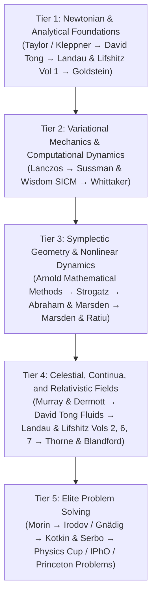

# 🌌 Classical Mechanics — Master Study Library & Curriculum

[](#)
[](#)
[](#)

A curated, graduate-level reference repository and self-study curriculum in **Classical Mechanics**, analytical dynamics, geometric & symplectic mechanics, chaos theory, continuum mechanics, relativistic dynamics, mathematical foundations, and elite Olympiad/qualifying problem solving.

---

## 📁 Repository Structure Overview

```
Classical Mechanics/
├── 01_Core_Mechanics/                               # Foundational graduate & undergraduate mechanics
├── 02_Alternative_Formulations_and_Classics/        # Variational principles, historical treatises, nonholonomic systems
├── 03_Geometric_and_Symplectic_Mechanics/           # Symplectic manifolds, Poisson geometry, reduction theory
├── 04_Nonlinear_Dynamics_and_Chaos/                 # Chaos, bifurcations, Hamiltonian dynamics, KAM theory
├── 05_Celestial_Mechanics_and_Rigid_Bodies/         # N-body problem, orbital mechanics, planetary resonances
├── 06_Continuum_Mechanics_and_Classical_Fields/     # Fluids, elasticity, wave equations, field theories
├── 07_Special_Relativity_and_Relativistic_Mechanics/# Relativistic kinematics, 4-vectors, action principles
├── 08_Statistical_Foundations/                      # Liouville theorem, ergodicity, phase space geometry
├── 09_Problems/                                     # Olympiad (IPhO, USAPhO, Physics Cup) & PhD qualifying problems
├── 10_Mathematics/                                  # Manifolds, Lie groups, differential forms, ODEs, variations
└── 11_Lectures/                                     # MIT OCW lecture series & problem sets (8.09, 8.223)
```

---

## 📚 Complete Library Catalog

### 01. Core Mechanics
The standard spine of undergraduate and graduate classical mechanics:
* **H. Goldstein, C. P. Poole, J. L. Safko** — *Classical Mechanics* (3rd Edition)
* **L. D. Landau, E. M. Lifshitz** — *Mechanics* (Course of Theoretical Physics, Vol. 1, 3rd Edition)
* **V. I. Arnold** — *Mathematical Methods of Classical Mechanics* (2nd Edition, Springer GTM 60)
* **David Tong** — *Classical Dynamics* (Cambridge DAMTP Lecture Notes)
* **David Tong** — *Dynamics and Relativity* (Cambridge DAMTP Lecture Notes)
* **G. J. Sussman, J. Wisdom** — *Structure and Interpretation of Classical Mechanics* (2nd Edition, MIT Press)
* **J. R. Taylor** — *Classical Mechanics*
* **D. Kleppner, R. Kolenkow** — *An Introduction to Mechanics* (2nd Edition)
* **M. Spivak** — *Physics for Mathematicians: Mechanics I*
* **L. N. Hand, J. D. Finch** — *Analytical Mechanics*
* **J. V. José, E. J. Saletan** — *Classical Dynamics: A Contemporary Approach*
* **A. L. Fetter, J. D. Walecka** — *Theoretical Mechanics of Particles and Continua*

### 02. Alternative Formulations & The Classics
Historical foundations, variational mechanics, and nonholonomic systems:
* **C. Lanczos** — *The Variational Principles of Mechanics* (4th Edition)
* **E. T. Whittaker** — *A Treatise on the Analytical Dynamics of Particles and Rigid Bodies*
* **F. R. Gantmacher** — *Lectures in Analytical Mechanics*
* **D. T. Greenwood** — *Advanced Dynamics*
* **D. T. Greenwood** — *Classical Dynamics*
* **A. Sommerfeld** — *Mechanics* (Lectures on Theoretical Physics, Vol. 1)
* **J. G. Papastavridis** — *Analytical Mechanics: A Comprehensive Treatise on the Dynamics of Constrained Systems* *(Tracked via Git LFS)*

### 03. Geometric and Symplectic Mechanics
Modern coordinate-free differential geometric mechanics and symmetries:
* **R. Abraham, J. E. Marsden** — *Foundations of Mechanics* (2nd Edition)
* **J. E. Marsden, T. S. Ratiu** — *Introduction to Mechanics and Symmetry* (2nd Edition)
* **V. I. Arnold, V. V. Kozlov, A. I. Neishtadt** — *Mathematical Aspects of Classical and Celestial Mechanics* (3rd Edition)
* **D. D. Holm, T. Schmah, C. Stoica** — *Geometric Mechanics and Symmetry: From Finite to Infinite Dimensions*

### 04. Nonlinear Dynamics and Chaos
Phase space flows, bifurcations, strange attractors, and KAM theory:
* **S. H. Strogatz** — *Nonlinear Dynamics and Chaos*
* **P. Cvitanović et al.** — *Chaos: Classical and Quantum* (ChaosBook.org)
* **E. Ott** — *Chaos in Dynamical Systems* (2nd Edition)
* **A. J. Lichtenberg, M. A. Lieberman** — *Regular and Chaotic Dynamics* (2nd Edition)
* **M. Tabor** — *Chaos and Integrability in Nonlinear Dynamics*

### 05. Celestial Mechanics and Rigid Bodies
Gravitational dynamics, perturbation methods, and attitude physics:
* **C. D. Murray, S. F. Dermott** — *Solar System Dynamics*
* **J. M. A. Danby** — *Fundamentals of Celestial Mechanics* (2nd Edition)
* **M. Valtonen, H. Karttunen** — *The Three-Body Problem*

### 06. Continuum Mechanics and Classical Fields
Infinite degrees of freedom, elasticity, hydrodynamics, and field theory:
* **David Tong** — *Fluid Mechanics* (Cambridge DAMTP)
* **L. D. Landau, E. M. Lifshitz** — *Fluid Mechanics* (Course of Theoretical Physics, Vol. 6)
* **L. D. Landau, E. M. Lifshitz** — *Theory of Elasticity* (Course of Theoretical Physics, Vol. 7)
* **K. S. Thorne, R. D. Blandford** — *Modern Classical Physics: Optics, Fluids, Plasmas, Elasticity, Relativity, and Statistical Physics*
* **D. J. Acheson** — *Elementary Fluid Dynamics*
* **M. E. Gurtin** — *An Introduction to Continuum Mechanics*

### 07. Special Relativity and Relativistic Mechanics
Four-vectors, Minkowski spacetime, relativistic collisions, and action principles:
* **L. D. Landau, E. M. Lifshitz** — *The Classical Theory of Fields* (Course of Theoretical Physics, Vol. 2)
* **E. F. Taylor, J. A. Wheeler** — *Spacetime Physics*
* **W. Rindler** — *Relativity: Special, General, and Cosmological* (2nd Edition)
* **S. Ainsaar, J. Kalda** — *Theory of Relativity*

### 08. Statistical Foundations
Connecting Hamiltonian dynamics with statistical ensembles:
* **V. I. Arnold, A. Avez** — *Ergodic Problems of Classical Mechanics*
* **M. Kardar** — *Statistical Physics of Particles*

### 09. Problems (Olympiad, Competition, and PhD Qualifying)
Elite problem collections with full solutions:
* **Jaan Kalda Study Guides** — *Problems in Classical Mechanics*, *Kinematics*, *Formulas for IPhO*, plus complete multi-language handouts and topical sheets (Kepler, Thermodynamics, Circuits, Wave Optics, Quantum).
* **International Physics Olympiad (IPhO)** — Past examination papers and theoretical solutions.
* **USAPhO** — Comprehensive past semifinal exams and official solution sets (2007–2018).
* **Physics Cup (NBPhO / World Olympiad)** — Elite physics competition problem sets.
* **D. Morin** — *Introduction to Classical Mechanics: With Problems and Solutions*
* **I. E. Irodov** — *Problems in General Physics*
* **S. S. Krotov** — *Aptitude Test in Physics*
* **O. Y. Savchenko** — *Problems in Physics*
* **P. Gnädig, G. Honyek, K. F. Riley** — *200 Puzzling Physics Problems* & *200 More Puzzling Physics Problems*
* **G. L. Kotkin, V. G. Serbo** — *Collection of Problems in Classical Mechanics*
* **Lim Yung-Kuo** — *Problems and Solutions on Mechanics*
* **S. B. Cahn, B. E. Nadgorny** — *A Guide to Physics Problems, Part 1: Mechanics, Relativity, and Electrodynamics*
* **N. Newbury et al.** — *Princeton Problems in Physics with Solutions*
* **A. P. Lightman, W. H. Press, R. H. Price, S. A. Teukolsky** — *Problem Book in Relativity and Gravitation*

### 10. Mathematics for Classical Mechanics
Rigorous mathematical foundations for modern dynamics:
* **S. Axler** — *Linear Algebra Done Right* (4th Edition)
* **M. Spivak** — *Calculus*
* **S. Abbott** — *Understanding Analysis*
* **V. I. Arnold** — *Ordinary Differential Equations*
* **I. M. Gelfand, S. V. Fomin** — *Calculus of Variations*
* **T. Needham** — *Visual Complex Analysis*
* **B. Schutz** — *Geometrical Methods of Mathematical Physics*
* **J. M. Lee** — *Introduction to Smooth Manifolds* (GTM 218)
* **B. C. Hall** — *Lie Groups, Lie Algebras, and Representations* (GTM 222)

### 11. Lectures & Course Archives
* **MIT OCW 8.09** — *Classical Mechanics III* (Graduate Level): Full lecture notes, problem sets, and solutions.
* **MIT OCW 8.223** — *Classical Mechanics II* (Undergraduate Level): Lecture notes, assignments, and exam review materials.

---

## 🧭 Optimal 5-Tier Mastery Path



1. **Tier 1: Newtonian & Analytical Foundations**
   * *Taylor* or *Kleppner & Kolenkow* $\rightarrow$ **David Tong (Classical Dynamics)** $\rightarrow$ **Landau & Lifshitz (Vol. 1)** $\rightarrow$ **Goldstein**.
   * Problems: **Morin**, **Jaan Kalda (Kinematics & Mechanics)**.
2. **Tier 2: Variational & Computational Dynamics**
   * **Lanczos (Variational Principles)** $\rightarrow$ **Sussman & Wisdom (SICM)** $\rightarrow$ **Whittaker**.
   * Problems: **Irodov**, **Gnädig (200 Puzzling Physics Problems)**.
3. **Tier 3: Symplectic Geometry & Nonlinear Dynamics**
   * **Arnold (Mathematical Methods)** $\rightarrow$ **Strogatz** $\rightarrow$ **Abraham & Marsden** $\rightarrow$ **Marsden & Ratiu**.
   * Chaos & Perturbations: **Lichtenberg & Lieberman**, **Cvitanović (ChaosBook)**.
4. **Tier 4: Gravitation, Continua, and Relativistic Fields**
   * **Murray & Dermott (Solar System Dynamics)** $\rightarrow$ **David Tong (Fluid Mechanics)** $\rightarrow$ **Landau & Lifshitz (Vols. 2, 6, 7)** $\rightarrow$ **Thorne & Blandford**.
5. **Tier 5: Elite Problem Solving (Qualifying & Olympiad Tier)**
   * **Kotkin & Serbo**, **Physics Cup**, **IPhO Past Exams**, **Lim Yung-Kuo**, **Princeton Problems**.

---

## 📦 Large File Storage (Git LFS)

This repository uses **Git LFS** for files exceeding 100 MB:
* `02_Alternative_Formulations_and_Classics/Papastavridis_Analytical_Mechanics.pdf` (~108.4 MB)

To ensure all LFS pointer files are downloaded when cloning:
```bash
git lfs install
git clone https://github.com/nerdorwhatX/becoming-gawd-classical-mechanics.git
cd becoming-gawd-classical-mechanics
git lfs pull
```
