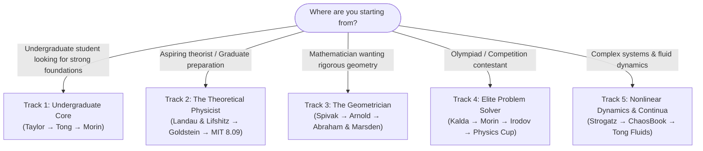

# 🌌 Classical Mechanics — The Ultimate Master Study Library & Curriculum

[](#)
[](#)
[](#)
[](#)

> *"Mechanics is the paradise of the mathematical sciences, because by means of it one comes to the fruits of mathematics."*  
> — Leonardo da Vinci

Welcome to the definitive self-study curriculum, pedagogical library, and reference archive for **Classical Mechanics**. This repository is structured to take any dedicated learner — from an undergraduate physics or math student to an aspiring theoretical physicist, Olympiad competitor, or researcher — all the way to complete mastery of analytical dynamics, symplectic geometry, chaos, and classical field theory.

---

## 📑 Table of Contents

1. [🎯 Choosing Your Study Track](#-choosing-your-study-track)
2. [🗺️ Master 5-Tier Learning Roadmap](#️-master-5-tier-learning-roadmap)
3. [📖 Textbook Field Guide & How to Read Them](#-textbook-field-guide--how-to-read-them)
4. [🗂️ Complete Curated Library Catalog](#️-complete-curated-library-catalog)
   * [01. Core Mechanics](#01-core-mechanics)
   * [02. Alternative Formulations & The Classics](#02-alternative-formulations--the-classics)
   * [03. Geometric and Symplectic Mechanics](#03-geometric-and-symplectic-mechanics)
   * [04. Nonlinear Dynamics, Chaos, and KAM Theory](#04-nonlinear-dynamics-chaos-and-kam-theory)
   * [05. Celestial Mechanics and Rigid Bodies](#05-celestial-mechanics-and-rigid-bodies)
   * [06. Continuum Mechanics and Classical Fields](#06-continuum-mechanics-and-classical-fields)
   * [07. Special Relativity and Relativistic Mechanics](#07-special-relativity-and-relativistic-mechanics)
   * [08. Statistical Foundations](#08-statistical-foundations)
   * [09. Elite Problem Archives & Olympiads](#09-elite-problem-archives--olympiads)
   * [10. Mathematics for Modern Mechanics](#10-mathematics-for-modern-mechanics)
   * [11. University Lecture Archives (MIT OCW)](#11-university-lecture-archives-mit-ocw)
5. [🧩 Problem Solving Progression Guide](#-problem-solving-progression-guide)
6. [💾 How to Clone & Download (Git LFS)](#-how-to-clone--download-git-lfs)

---

## 🎯 Choosing Your Study Track

Every learner starts from a different background. Choose the track that aligns with your current goals:



### 🔹 Track 1: The Undergraduate Physics Core (Newtonian to Analytical)
* **Goal**: Build physical intuition and transition seamlessly into Lagrangian and Hamiltonian mechanics.
* **Primary Reading**:
  1. [Taylor — Classical Mechanics](01_Core_Mechanics/Taylor_Classical_Mechanics.pdf) or [Kleppner & Kolenkow — An Introduction to Mechanics](01_Core_Mechanics/Kleppner_Kolenkow_Introduction_to_Mechanics.pdf)
  2. [David Tong — Classical Dynamics](01_Core_Mechanics/David_Tong_Classical_Dynamics.pdf)
* **Problem Companion**: [Morin — Introduction to Classical Mechanics](09_Problems/Morin_Introduction_to_Classical_Mechanics.pdf) (Chapters 1–7).
* **Key Milestones**: Generalized coordinates, d'Alembert's principle, Euler-Lagrange equations, central force orbits, small oscillations, and inertia tensors.

---

### 🔹 Track 2: The Theoretical Physicist's Path (Ph.D. & Graduate Core)
* **Goal**: Complete mastery of the variational and Hamiltonian machinery powering quantum mechanics, field theory, and modern theoretical physics.
* **Primary Reading**:
  1. [Landau & Lifshitz — Mechanics (Vol. 1)](01_Core_Mechanics/Landau_Lifshitz_Mechanics_Vol1.pdf) *(Read cover-to-cover)*
  2. [Goldstein, Poole & Safko — Classical Mechanics](01_Core_Mechanics/Goldstein_Poole_Safko_Classical_Mechanics.pdf) *(Chapters 1–10)*
  3. [MIT OCW 8.09 — Classical Mechanics III Lecture Notes](11_Lectures/MIT_OCW_8.09_Classical_Mechanics_III/MIT8_09F14_full.pdf)
* **Key Milestones**: Principle of Least Action, Noether's theorem, Legendre transforms, Poisson brackets, Canonical Transformations, Generating functions, Hamilton-Jacobi equation, Action-Angle variables, and Adiabatic invariants.

---

### 🔹 Track 3: The Geometrician's Path (Coordinate-Free & Symplectic Geometry)
* **Goal**: Understand mechanics through the lens of differential geometry, smooth manifolds, symplectic topology, and Lie group symmetries.
* **Prerequisites**: [Lee — Smooth Manifolds](10_Mathematics/Lee_Introduction_to_Smooth_Manifolds.pdf), [Axler — Linear Algebra](10_Mathematics/Axler_Linear_Algebra_Done_Right_4th_Ed.pdf).
* **Primary Reading**:
  1. [Spivak — Physics for Mathematicians: Mechanics I](01_Core_Mechanics/Spivak_Physics_for_Mathematicians_Mechanics_I.djvu)
  2. [Arnold — Mathematical Methods of Classical Mechanics](01_Core_Mechanics/Arnold_Mathematical_Methods_Classical_Mechanics.pdf)
  3. [Abraham & Marsden — Foundations of Mechanics](03_Geometric_and_Symplectic_Mechanics/Abraham_Marsden_Foundations_of_Mechanics_2nd_Ed.pdf)
  4. [Marsden & Ratiu — Introduction to Mechanics and Symmetry](03_Geometric_and_Symplectic_Mechanics/Marsden_Ratiu_Introduction_Mechanics_Symmetry.pdf)
* **Key Milestones**: Tangent and cotangent bundles, symplectic 2-forms $\omega$, Hamiltonian vector fields $X_H$, Poisson manifolds, Lie group actions on manifolds, momentum maps, and Marsden-Weinstein reduction.

---

### 🔹 Track 4: The Elite Problem Solver (Olympiad / IPhO / Physics Cup)
* **Goal**: Develop lightning-fast mechanical intuition, non-standard problem-solving techniques, and competitive mastery.
* **Primary Training**:
  1. [Jaan Kalda — Problems in Classical Mechanics](09_Problems/Jaan_Kalda_Problems_in_Classical_Mechanics.pdf) & [Kinematics](09_Problems/Jaan_Kalda_Kinematics.pdf)
  2. [Irodov — Problems in General Physics](09_Problems/Irodov_Problems_General_Physics.pdf) (Part 1: Mechanics)
  3. [Gnädig, Honyek, Riley — 200 Puzzling Physics Problems](09_Problems/Gnadig_Honyek_Riley_200_Puzzling_Physics_Problems.pdf)
  4. [USAPhO Past Semifinal Exams](09_Problems/USAPhO_Past_Exams/) & [IPhO Past Papers](09_Problems/IPhO_Past_Papers/)
  5. [Physics Cup Competition Archives](09_Problems/Physics_Cup/)
* **Key Milestones**: Virtual work, instantaneous centers of rotation, clever rotating reference frames, velocity hodographs, invariant geometric quantities, and friction dynamics.

---

### 🔹 Track 5: Nonlinear Dynamics, Chaos, and Continua
* **Goal**: Explore deterministic chaos, phase-space geometry, fractal attractors, and fluid/elastic media.
* **Primary Reading**:
  1. [Strogatz — Nonlinear Dynamics and Chaos](04_Nonlinear_Dynamics_and_Chaos/Strogatz_Nonlinear_Dynamics_and_Chaos.pdf)
  2. [Cvitanović et al. — Chaos: Classical and Quantum](04_Nonlinear_Dynamics_and_Chaos/Cvitanovic_Chaos_Classical_and_Quantum.pdf)
  3. [David Tong — Fluid Mechanics](06_Continuum_Mechanics_and_Classical_Fields/David_Tong_Fluid_Mechanics.pdf)
  4. [Landau & Lifshitz — Fluid Mechanics (Vol. 6)](06_Continuum_Mechanics_and_Classical_Fields/Landau_Lifshitz_Fluid_Mechanics_Vol6.pdf) & [Theory of Elasticity (Vol. 7)](06_Continuum_Mechanics_and_Classical_Fields/Landau_Lifshitz_Theory_of_Elasticity_Vol7.pdf)
* **Key Milestones**: Phase portraits, bifurcations, strange attractors, Lyapunov exponents, Poincaré sections, KAM theorem, Navier-Stokes equations, and stress-strain tensors.

---

## 🗺️ Master 5-Tier Learning Roadmap

```
══════════════════════════════════════════════════════════════════════════════════════
TIER 1: NEWTONIAN & ANALYTICAL FOUNDATIONS
   Newton's Laws • Kinematics • Conservation of P & L • Energy • Center of Mass
   Lagrangian Formulation • Generalized Coordinates • d'Alembert's Principle
   📚 Books: Taylor • Kleppner & Kolenkow • David Tong (Classical Dynamics)
   🧩 Problems: Morin • Kalda (Mechanics & Kinematics)
══════════════════════════════════════════════════════════════════════════════════════
                                    ▼
══════════════════════════════════════════════════════════════════════════════════════
TIER 2: VARIATIONAL PRINCIPLES & ADVANCED ANALYTICAL DYNAMICS
   Principle of Least Action • Symmetries & Noether's Theorem • Central Force Problem
   Rigid Body Dynamics (Euler Angles & Inertia Tensor) • Small Oscillations & Normal Modes
   Computational Dynamics (Scheme/SICM) • Nonholonomic Systems
   📚 Books: Landau & Lifshitz (Vol 1) • Goldstein (Ch. 1-7) • Lanczos • Sussman & Wisdom
   🧩 Problems: Irodov • Gnädig (200 Puzzling Problems)
══════════════════════════════════════════════════════════════════════════════════════
                                    ▼
══════════════════════════════════════════════════════════════════════════════════════
TIER 3: HAMILTONIAN MECHANICS, SYMPLECTIC GEOMETRY & CHAOS
   Phase Space • Legendre Transformation • Hamilton's Equations • Poisson Brackets
   Canonical Transformations • Generating Functions • Hamilton-Jacobi Theory
   Action-Angle Variables • Symplectic Manifolds • Chaos & KAM Theory
   📚 Books: Goldstein (Ch. 8-11) • Arnold (Math Methods) • Abraham & Marsden • Strogatz
   🧩 Problems: Kotkin & Serbo • MIT OCW 8.09 Problem Sets
══════════════════════════════════════════════════════════════════════════════════════
                                    ▼
══════════════════════════════════════════════════════════════════════════════════════
TIER 4: CONTINUOUS MEDIA, GRAVITATION & RELATIVISTIC FIELDS
   Hydrodynamics & Navier-Stokes • Stress-Strain & Elasticity • Celestial Perturbations
   N-body Problem • Relativistic Mechanics & 4-Vectors • Relativistic Action Principles
   Classical Field Theory & Energy-Momentum Tensors
   📚 Books: David Tong (Fluids) • Landau & Lifshitz (Vols 2, 6, 7) • Murray & Dermott
   🧩 Problems: Lightman (Relativity Book) • Newbury (Princeton Problems)
══════════════════════════════════════════════════════════════════════════════════════
                                    ▼
══════════════════════════════════════════════════════════════════════════════════════
TIER 5: ELITE PROBLEM SOLVING & RESEARCH SYNTHESIS
   High-Difficulty Olympiad Problems • Doctoral Qualifying Exams • Geometric Reduction
   Lie Group Symmetry Breaking • Ergodic Foundations & Statistical Mechanics
   📚 Books: Arnold & Avez • Marsden & Ratiu • Thorne & Blandford
   🧩 Problems: Physics Cup • IPhO Finals • USAPhO Semifinals • Lim Yung-Kuo
══════════════════════════════════════════════════════════════════════════════════════
```

---

## 📖 Textbook Field Guide & How to Read Them

### 1. **Landau & Lifshitz — *Mechanics (Vol. 1)***
* **Why It's Legendary**: Derives all of classical mechanics starting from the Principle of Least Action and spacetime symmetries (homogeneity and isotropy) on page 1. Noether's theorem falls out naturally without artificial coordinate machinery.
* **How to Read**: It is extremely dense. Every sentence and mathematical step is loaded with physical content. Do not read it passively: **re-derive every calculation on a blank notepad**.

### 2. **Herbert Goldstein — *Classical Mechanics (3rd Ed.)***
* **Why It's Legendary**: The worldwide graduate standard. Nothing matches its comprehensive treatment of Canonical Transformations (Chapter 9) and Hamilton-Jacobi Theory (Chapter 10).
* **How to Read**: Read David Tong or Taylor first for pedagogical clarity, then use Goldstein to build rigorous mastery of Hamiltonian transformations, action-angle variables, and canonical perturbation theory.

### 3. **David Tong — *Classical Dynamics***
* **Why It's Legendary**: Perhaps the most pedagogical and engaging set of modern lecture notes ever written for analytical mechanics. Free from archaic notation; directly prepares you for Quantum Field Theory.
* **How to Read**: An ideal primary or parallel textbook for your first graduate-level encounter with Lagrangians and Hamiltonians.

### 4. **V. I. Arnold — *Mathematical Methods of Classical Mechanics***
* **Why It's Legendary**: The ultimate bridge between physics and modern differential geometry. Arnold translates mechanics from coordinate calculations into geometric statements about differential forms, symplectic manifolds, and phase flows.
* **How to Read**: Study alongside [Schutz](10_Mathematics/Schutz_Geometrical_Methods_Mathematical_Physics.pdf) or [Lee](10_Mathematics/Lee_Introduction_to_Smooth_Manifolds.pdf). Pay special attention to the appendices, which are mathematical goldmines.

### 5. **Sussman & Wisdom — *Structure and Interpretation of Classical Mechanics (SICM)***
* **Why It's Legendary**: Eliminates all ambiguity in traditional mathematical notation (such as confusing total time derivatives with partial derivatives of Lagrangian functions) by formulating mechanics in executable Scheme code.
* **How to Read**: Work through the webbook or PDF while writing small computer scripts to evaluate orbits, perturbation series, and chaotic phase portraits.

### 6. **David Morin — *Introduction to Classical Mechanics***
* **Why It's Legendary**: Contains the best, most thoroughly worked problem sets in existence for intermediate mechanics. Famous for its limericks and deep physical explanations of subtleties.
* **How to Read**: Don't just read the solutions! Attempt each problem for at least 30–45 minutes before looking at Morin's solution.

### 7. **Cornelius Lanczos — *The Variational Principles of Mechanics***
* **Why It's Legendary**: A philosophical and conceptual masterpiece. Lanczos explains *why* the variational approach works, d'Alembert's principle, and the deep transition from statics to dynamics.
* **How to Read**: Read this alongside Goldstein when studying constraints and Hamilton's principle to achieve true conceptual depth.

---

## 🗂️ Complete Curated Library Catalog

### 01. Core Mechanics
The primary graduate and advanced undergraduate curriculum:

| Book / Resource | Author(s) | Format | Focus & Highlights |
| :--- | :--- | :--- | :--- |
| [**Classical Mechanics (3rd Ed.)**](01_Core_Mechanics/Goldstein_Poole_Safko_Classical_Mechanics.pdf) | H. Goldstein, C. P. Poole, J. L. Safko | PDF (19.2 MB) | The graduate standard; canonical transformations & Hamilton-Jacobi |
| [**Mechanics (Vol. 1, 3rd Ed.)**](01_Core_Mechanics/Landau_Lifshitz_Mechanics_Vol1.pdf) | L. D. Landau, E. M. Lifshitz | PDF (76.5 MB) | The gold standard of theoretical mechanics; derived from symmetry |
| [**Mathematical Methods of Classical Mechanics**](01_Core_Mechanics/Arnold_Mathematical_Methods_Classical_Mechanics.pdf) | V. I. Arnold | PDF (41.2 MB) | Modern geometric formulation: differential forms & symplectic manifolds |
| [**Classical Dynamics**](01_Core_Mechanics/David_Tong_Classical_Dynamics.pdf) | David Tong | PDF (1.09 MB) | Cambridge DAMTP notes; lucid modern presentation of analytical mechanics |
| [**Dynamics and Relativity**](01_Core_Mechanics/David_Tong_Dynamics_and_Relativity.pdf) | David Tong | PDF (1.25 MB) | Cambridge DAMTP notes; Newtonian foundations bridging to relativity |
| [**Structure and Interpretation of Classical Mechanics**](01_Core_Mechanics/Sussman_Wisdom_Structure_Interpretation_Classical_Mechanics.pdf) | G. J. Sussman, J. Wisdom | PDF (9.1 MB) | Computational analytical mechanics; eliminates mathematical ambiguities |
| [**SICM Webbook (Full HTML Version)**](01_Core_Mechanics/Sussman_Wisdom_Structure_and_Interpretation_of_Classical_Mechanics_2nd_Ed/) | G. J. Sussman, J. Wisdom | HTML Dir | Complete interactive MIT Press webbook |
| [**Classical Mechanics**](01_Core_Mechanics/Taylor_Classical_Mechanics.pdf) | John R. Taylor | PDF (16.9 MB) | Premier undergraduate foundation connecting Newton to Lagrange & Hamilton |
| [**An Introduction to Mechanics (2nd Ed.)**](01_Core_Mechanics/Kleppner_Kolenkow_Introduction_to_Mechanics.pdf) | D. Kleppner, R. Kolenkow | PDF (23.6 MB) | Rigorous introductory mechanics; exceptional problem sets |
| [**Physics for Mathematicians: Mechanics I**](01_Core_Mechanics/Spivak_Physics_for_Mathematicians_Mechanics_I.djvu) | Michael Spivak | DJVU (7.3 MB) | Analytical mechanics explained rigorously from a pure mathematician's mind |
| [**Analytical Mechanics**](01_Core_Mechanics/Hand_Finch_Analytical_Mechanics.pdf) | L. N. Hand, J. D. Finch | PDF (0.68 MB) | Pedagogical, clear exposition of constraints, Lagrangians, and Hamiltonians |
| [**Classical Dynamics: A Contemporary Approach**](01_Core_Mechanics/Jose_Saletan_Classical_Dynamics.pdf) | J. V. José, E. J. Saletan | PDF (0.47 MB) | Modern perspective uniting analytical mechanics with geometric ideas |
| [**Theoretical Mechanics of Particles & Continua**](01_Core_Mechanics/Fetter_Walecka_Theoretical_Mechanics.djvu) | A. L. Fetter, J. D. Walecka | DJVU (5.9 MB) | Bridges discrete multi-particle systems to continuous fluids and fields |

---

### 02. Alternative Formulations & The Classics
Historical masterpieces, variational mechanics, and nonholonomic systems:

| Book / Resource | Author(s) | Format | Focus & Highlights |
| :--- | :--- | :--- | :--- |
| [**The Variational Principles of Mechanics (4th Ed.)**](02_Alternative_Formulations_and_Classics/Lanczos_Variational_Principles_of_Mechanics.pdf) | Cornelius Lanczos | PDF (16.8 MB) | Philosophical & physical treatise on action principles & constraints |
| [**Analytical Dynamics of Particles & Rigid Bodies**](02_Alternative_Formulations_and_Classics/Whittaker_Analytical_Dynamics_of_Particles_and_Rigid_Bodies.pdf) | E. T. Whittaker | PDF (30.0 MB) | The historic classic treatise of analytical dynamics |
| [**Lectures in Analytical Mechanics**](02_Alternative_Formulations_and_Classics/Gantmacher_Lectures_Analytical_Mechanics.djvu) | F. R. Gantmacher | DJVU (3.6 MB) | Soviet masterwork on stability, variational principles, and oscillations |
| [**Advanced Dynamics**](02_Alternative_Formulations_and_Classics/Greenwood_Advanced_Dynamics.pdf) | Donald T. Greenwood | PDF (10.9 MB) | Rigorous treatment of nonholonomic systems and Kane's equations |
| [**Classical Dynamics**](02_Alternative_Formulations_and_Classics/Greenwood_Classical_Dynamics.djvu) | Donald T. Greenwood | DJVU (4.6 MB) | Concise, authoritative presentation of analytical mechanics |
| [**Mechanics (Lectures on Theoretical Physics Vol. 1)**](02_Alternative_Formulations_and_Classics/Sommerfeld_Mechanics_Vol1.pdf) | Arnold Sommerfeld | PDF (15.5 MB) | Master lectures from one of the founding fathers of modern physics |
| [**Analytical Mechanics**](02_Alternative_Formulations_and_Classics/Papastavridis_Analytical_Mechanics.pdf) *(Git LFS)* | J. G. Papastavridis | PDF (108.4 MB) | The most exhaustive encyclopedia on constrained and nonholonomic dynamics |

---

### 03. Geometric and Symplectic Mechanics
Coordinate-free mechanics, symplectic geometry, Lie algebras, and reduction theory:

| Book / Resource | Author(s) | Format | Focus & Highlights |
| :--- | :--- | :--- | :--- |
| [**Foundations of Mechanics (2nd Ed.)**](03_Geometric_and_Symplectic_Mechanics/Abraham_Marsden_Foundations_of_Mechanics_2nd_Ed.pdf) | R. Abraham, J. E. Marsden | PDF (86.7 MB) | The definitive treatise on geometric mechanics and symplectic manifolds |
| [**Introduction to Mechanics and Symmetry (2nd Ed.)**](03_Geometric_and_Symplectic_Mechanics/Marsden_Ratiu_Introduction_Mechanics_Symmetry.pdf) | J. E. Marsden, T. S. Ratiu | PDF (7.4 MB) | Momentum maps, Lie-Poisson brackets, and symmetry reduction |
| [**Mathematical Aspects of Classical & Celestial Mechanics**](03_Geometric_and_Symplectic_Mechanics/Arnold_Kozlov_Neishtadt_Mathematical_Aspects_Classical_Celestial_Mechanics.pdf) | V. I. Arnold, V. V. Kozlov, A. I. Neishtadt | PDF (20.3 MB) | Celestial mechanics, perturbation theory, and Hamiltonian systems |
| [**Geometric Mechanics and Symmetry**](03_Geometric_and_Symplectic_Mechanics/Holm_Schmah_Stoica_Geometric_Mechanics_Symmetry.pdf) | D. D. Holm, T. Schmah, C. Stoica | PDF (3.8 MB) | From finite-dimensional particle systems to infinite-dimensional fluids |

---

### 04. Nonlinear Dynamics, Chaos, and KAM Theory
Dynamical systems, bifurcations, phase space flows, and Hamiltonian chaos:

| Book / Resource | Author(s) | Format | Focus & Highlights |
| :--- | :--- | :--- | :--- |
| [**Nonlinear Dynamics and Chaos**](04_Nonlinear_Dynamics_and_Chaos/Strogatz_Nonlinear_Dynamics_and_Chaos.pdf) | Steven H. Strogatz | PDF (10.9 MB) | The most accessible and beloved introduction to nonlinear dynamics |
| [**Chaos: Classical and Quantum (v17)**](04_Nonlinear_Dynamics_and_Chaos/Cvitanovic_Chaos_Classical_and_Quantum.pdf) | P. Cvitanović et al. | PDF (8.2 MB) | Trace formulas, periodic orbit theory, and deterministic chaos |
| [**Chaos in Dynamical Systems (2nd Ed.)**](04_Nonlinear_Dynamics_and_Chaos/Ott_Chaos_Dynamical_Systems.pdf) | Edward Ott | PDF (35.7 MB) | Fractal dimensions, strange attractors, and chaotic transport |
| [**Regular and Chaotic Dynamics (2nd Ed.)**](04_Nonlinear_Dynamics_and_Chaos/Lichtenberg_Lieberman_Regular_Chaotic_Dynamics.djvu) | A. J. Lichtenberg, M. A. Lieberman | DJVU (7.2 MB) | Canonical perturbation theory, resonance overlap, and KAM theorem |
| [**Chaos and Integrability in Nonlinear Dynamics**](04_Nonlinear_Dynamics_and_Chaos/Tabor_Chaos_Integrability_Nonlinear_Dynamics.djvu) | Michael Tabor | DJVU (4.2 MB) | Integrable vs non-integrable Hamiltonian systems and soliton physics |

---

### 05. Celestial Mechanics and Rigid Bodies
Gravitational dynamics, orbital mechanics, perturbations, and multi-body systems:

| Book / Resource | Author(s) | Format | Focus & Highlights |
| :--- | :--- | :--- | :--- |
| [**Solar System Dynamics**](05_Celestial_Mechanics_and_Rigid_Bodies/Murray_Dermott_Solar_System_Dynamics.pdf) | C. D. Murray, S. F. Dermott | PDF (1.8 MB) | The bible of planetary perturbation theory, resonances, and tidal evolution |
| [**Fundamentals of Celestial Mechanics (2nd Ed.)**](05_Celestial_Mechanics_and_Rigid_Bodies/Danby_Fundamentals_Celestial_Mechanics.pdf) | J. M. A. Danby | PDF (27.9 MB) | Keplerian orbits, orbit determination, and numerical integration |
| [**The Three-Body Problem**](05_Celestial_Mechanics_and_Rigid_Bodies/Valtonen_Karttunen_Three_Body_Problem.pdf) | M. Valtonen, H. Karttunen | PDF (1.8 MB) | Restricted, general, and statistical three-body physics |

---

### 06. Continuum Mechanics and Classical Fields
Elasticity, hydrodynamics, wave mechanics, and infinite-dimensional systems:

| Book / Resource | Author(s) | Format | Focus & Highlights |
| :--- | :--- | :--- | :--- |
| [**Fluid Mechanics**](06_Continuum_Mechanics_and_Classical_Fields/David_Tong_Fluid_Mechanics.pdf) | David Tong | PDF (10.8 MB) | Cambridge DAMTP notes on ideal fluids, vorticity, viscosity, and turbulence |
| [**Fluid Mechanics (Vol. 6, 2nd Ed.)**](06_Continuum_Mechanics_and_Classical_Fields/Landau_Lifshitz_Fluid_Mechanics_Vol6.pdf) | L. D. Landau, E. M. Lifshitz | PDF (22.2 MB) | Theoretical hydrodynamics, boundary layers, sound waves, and shocks |
| [**Theory of Elasticity (Vol. 7, 3rd Ed.)**](06_Continuum_Mechanics_and_Classical_Fields/Landau_Lifshitz_Theory_of_Elasticity_Vol7.pdf) | L. D. Landau, E. M. Lifshitz | PDF (12.4 MB) | Strain/stress tensors, elastic waves, rods, plates, and dislocation theory |
| [**Modern Classical Physics**](06_Continuum_Mechanics_and_Classical_Fields/Thorne_Blandford_Modern_Classical_Physics.pdf) | K. S. Thorne, R. D. Blandford | PDF (44.6 MB) | Master treatise bridging fluids, optics, plasmas, elasticity, and spacetime |
| [**Elementary Fluid Dynamics**](06_Continuum_Mechanics_and_Classical_Fields/Acheson_Elementary_Fluid_Dynamics.pdf) | D. J. Acheson | PDF (31.7 MB) | Intuitive, physics-rich exposition of fluids, waves, and instability |
| [**An Introduction to Continuum Mechanics**](06_Continuum_Mechanics_and_Classical_Fields/Gurtin_Introduction_Continuum_Mechanics.pdf) | Morton E. Gurtin | PDF (15.5 MB) | Mathematically rigorous continuum kinematics, stress, and constitutive laws |

---

### 07. Special Relativity and Relativistic Mechanics
Minkowski spacetime geometry, 4-vectors, and relativistic action principles:

| Book / Resource | Author(s) | Format | Focus & Highlights |
| :--- | :--- | :--- | :--- |
| [**The Classical Theory of Fields (Vol. 2, 4th Ed.)**](07_Special_Relativity_and_Relativistic_Mechanics/Landau_Lifshitz_Classical_Theory_Fields_Vol2.pdf) | L. D. Landau, E. M. Lifshitz | PDF (15.6 MB) | Relativistic particle mechanics and electromagnetic field action |
| [**Spacetime Physics (2nd Ed.)**](07_Special_Relativity_and_Relativistic_Mechanics/Taylor_Wheeler_Spacetime_Physics.djvu) | E. F. Taylor, J. A. Wheeler | DJVU (4.2 MB) | Geometric spacetime intuition and relativistic kinematics |
| [**Relativity: Special, General, and Cosmological**](07_Special_Relativity_and_Relativistic_Mechanics/Rindler_Relativity_Special_General_Cosmological.pdf) | Wolfgang Rindler | PDF (14.2 MB) | Rigorous introduction to 4-tensors, Minkowski diagrams, and collisions |
| [**Theory of Relativity**](07_Special_Relativity_and_Relativistic_Mechanics/Siim_Ainsaar_Theory_of_Relativity.pdf) | S. Ainsaar (ed. J. Kalda) | PDF (1.03 MB) | IPhO training guide; rapid mastery of relativistic mechanics & kinematics |

---

### 08. Statistical Foundations
Connecting Hamiltonian flows with ergodic theory and statistical ensembles:

| Book / Resource | Author(s) | Format | Focus & Highlights |
| :--- | :--- | :--- | :--- |
| [**Ergodic Problems of Classical Mechanics**](08_Statistical_Foundations/Arnold_Avez_Ergodic_Problems_Classical_Mechanics.pdf) | V. I. Arnold, A. Avez | PDF (16.2 MB) | Phase space volume conservation, Poincaré recurrence, ergodicity, and mixing |
| [**Statistical Physics of Particles**](08_Statistical_Foundations/Kardar_Statistical_Physics_Particles.pdf) | Mehran Kardar | PDF (2.8 MB) | MIT graduate course connecting phase space microstates to thermodynamics |

---

### 09. Elite Problem Archives & Olympiads
World-class problem collections, university qualifying exams, and international Olympiads:

#### 🏆 International Competitions & Past Exams
* [**IPhO Past Examination Papers & Solutions**](09_Problems/IPhO_Past_Papers/): Official competition problems and marking schemes from the International Physics Olympiad.
* [**USAPhO Semifinal Examination Archives (2007–2019)**](09_Problems/USAPhO_Past_Exams/): Complete past exams, solutions, and $F=ma$ contest papers.
* [**Physics Cup (NBPhO / World Olympiad)**](09_Problems/Physics_Cup/): Selected problem sets from the most grueling physics competition in the world.

#### 📚 Master Problem Collections
* [**Jaan Kalda's Study Guides**](09_Problems/):
  * [Problems in Classical Mechanics](09_Problems/Jaan_Kalda_Problems_in_Classical_Mechanics.pdf)
  * [Kinematics Guide](09_Problems/Jaan_Kalda_Kinematics.pdf)
  * [Formulas for IPhO](09_Problems/Jaan_Kalda_Formulas_for_IPhO.pdf)
  * [Thermodynamics](09_Problems/Jaan_Kalda_Thermodynamics.pdf), [Wave Optics](09_Problems/Jaan_Kalda_Wave_Optics.pdf), [Electrical Circuits](09_Problems/Jaan_Kalda_Electrical_Circuits.pdf)
* [**David Morin — Introduction to Classical Mechanics (With Problems & Solutions)**](09_Problems/Morin_Introduction_to_Classical_Mechanics.pdf)
* [**I. E. Irodov — Problems in General Physics**](09_Problems/Irodov_Problems_General_Physics.pdf)
* [**S. S. Krotov — Aptitude Test in Physics**](09_Problems/Krotov_Aptitude_Test_in_Physics.pdf)
* [**O. Y. Savchenko — Problems in Physics**](09_Problems/Savchenko_Problems_in_Physics.pdf)
* [**P. Gnädig, G. Honyek, K. F. Riley — 200 Puzzling Physics Problems**](09_Problems/Gnadig_Honyek_Riley_200_Puzzling_Physics_Problems.pdf)
* [**P. Gnädig, G. Honyek, K. F. Riley — 200 More Puzzling Physics Problems**](09_Problems/Gnadig_Honyek_Riley_200_More_Puzzling_Physics_Problems.pdf)
* [**G. L. Kotkin, V. G. Serbo — Collection of Problems in Classical Mechanics**](09_Problems/Kotkin_Serbo_Collection_Problems_Classical_Mechanics.pdf)
* [**Lim Yung-Kuo — Problems and Solutions on Mechanics**](09_Problems/Lim_Yung_Kuo_Problems_and_Solutions_on_Mechanics.pdf)
* [**S. B. Cahn, B. E. Nadgorny — A Guide to Physics Problems (Part 1: Mechanics)**](09_Problems/Cahn_Nadgorny_Guide_to_Physics_Problems_Part1.pdf)
* [**N. Newbury et al. — Princeton Problems in Physics with Solutions**](09_Problems/Newbury_Princeton_Problems_in_Physics.pdf)
* [**A. P. Lightman et al. — Problem Book in Relativity and Gravitation**](09_Problems/Lightman_Problem_Book_in_Relativity_and_Gravitation.pdf)

---

### 10. Mathematics for Modern Mechanics
Mathematical machinery essential for analytical and geometric dynamics:

| Book / Resource | Author(s) | Format | Role in Mechanics |
| :--- | :--- | :--- | :--- |
| [**Linear Algebra Done Right (4th Ed.)**](10_Mathematics/Axler_Linear_Algebra_Done_Right_4th_Ed.pdf) | Sheldon Axler | PDF (2.7 MB) | Vector spaces, inner products, spectral theorem for normal modes |
| [**Calculus**](10_Mathematics/Spivak_Calculus.pdf) | Michael Spivak | PDF (16.9 MB) | Rigorous single-variable calculus and analysis foundation |
| [**Understanding Analysis**](10_Mathematics/Abbott_Understanding_Analysis.pdf) | Stephen Abbott | PDF (1.6 MB) | Real analysis, metric spaces, convergence of dynamic series |
| [**Ordinary Differential Equations**](10_Mathematics/Arnold_Ordinary_Differential_Equations.pdf) | V. I. Arnold | PDF (13.6 MB) | Geometric theory of ODEs, phase portraits, stability, and flows |
| [**Calculus of Variations**](10_Mathematics/Gelfand_Fomin_Calculus_of_Variations.pdf) | I. M. Gelfand, S. V. Fomin | PDF (16.5 MB) | Functionals, Euler-Lagrange equations, second variation, Jacobi fields |
| [**Visual Complex Analysis**](10_Mathematics/Needham_Visual_Complex_Analysis.pdf) | Tristan Needham | PDF (31.7 MB) | Conformal maps, complex potentials for 2D hydrodynamics |
| [**Geometrical Methods of Mathematical Physics**](10_Mathematics/Schutz_Geometrical_Methods_Mathematical_Physics.pdf) | Bernard Schutz | PDF (13.2 MB) | Differential forms, exterior calculus, and Lie derivatives |
| [**Introduction to Smooth Manifolds**](10_Mathematics/Lee_Introduction_to_Smooth_Manifolds.pdf) | John M. Lee | PDF (8.8 MB) | Coordinate charts, tangent bundles, Riemannian metrics, and forms |
| [**Lie Groups, Lie Algebras, & Representations**](10_Mathematics/Hall_Lie_Groups_Lie_Algebras_Representations.pdf) | Brian C. Hall | PDF (3.2 MB) | Symmetries, matrix Lie groups, rotation group SO(3), momentum maps |

---

### 11. University Lecture Archives (MIT OCW)

#### 🏛️ [MIT OCW 8.09 — Classical Mechanics III (Graduate)](11_Lectures/MIT_OCW_8.09_Classical_Mechanics_III/)
* **Complete Course Notes**: [MIT 8.09 Full Lecture Notes (Chapters 1–7)](11_Lectures/MIT_OCW_8.09_Classical_Mechanics_III/MIT8_09F14_full.pdf)
* **By Chapters**:
  * [Chapter 1: Review of Lagrangian Mechanics](11_Lectures/MIT_OCW_8.09_Classical_Mechanics_III/MIT8_09F14_Chapter_1.pdf)
  * [Chapter 2: Symmetries & Conservation Laws](11_Lectures/MIT_OCW_8.09_Classical_Mechanics_III/MIT8_09F14_Chapter_2.pdf)
  * [Chapter 3: Central Forces & Scattering](11_Lectures/MIT_OCW_8.09_Classical_Mechanics_III/MIT8_09F14_Chapter_3.pdf)
  * [Chapter 4: Small Oscillations](11_Lectures/MIT_OCW_8.09_Classical_Mechanics_III/MIT8_09F14_Chapter_4.pdf)
  * [Chapter 5: Rigid Body Motion](11_Lectures/MIT_OCW_8.09_Classical_Mechanics_III/MIT8_09F14_Chapter_5.pdf)
  * [Chapter 6: Hamiltonian Mechanics & Canonical Transformations](11_Lectures/MIT_OCW_8.09_Classical_Mechanics_III/MIT8_09F14_Chapter_6.pdf)
  * [Chapter 7: Hamilton-Jacobi & Action-Angle Variables](11_Lectures/MIT_OCW_8.09_Classical_Mechanics_III/MIT8_09F14_Chapter_7.pdf)
* **Problem Sets**: Full series of 10 problem sets ([pset1](11_Lectures/MIT_OCW_8.09_Classical_Mechanics_III/MIT8_09F14_pset1.pdf) through [pset10](11_Lectures/MIT_OCW_8.09_Classical_Mechanics_III/MIT8_09F14_pset10.pdf)).

#### 🏛️ [MIT OCW 8.223 — Classical Mechanics II (Undergraduate)](11_Lectures/MIT_OCW_8.223_Classical_Mechanics_II/)
* **Lectures**: 18 individual lecture handouts ([Lec 1](11_Lectures/MIT_OCW_8.223_Classical_Mechanics_II/MIT8_223IAP17_Lec1.pdf) to [Lec 18](11_Lectures/MIT_OCW_8.223_Classical_Mechanics_II/MIT8_223IAP17_Lec18.pdf)).
* **Problem Sets & Complete Solutions**:
  * [Problem Set 1](11_Lectures/MIT_OCW_8.223_Classical_Mechanics_II/MIT8_223IAP17_pset1.pdf) & [Solutions](11_Lectures/MIT_OCW_8.223_Classical_Mechanics_II/mit8_223_iap17_pset1_sol.pdf)
  * [Problem Set 2](11_Lectures/MIT_OCW_8.223_Classical_Mechanics_II/MIT8_223IAP17_pset2.pdf) & [Solutions](11_Lectures/MIT_OCW_8.223_Classical_Mechanics_II/mit8_223_iap17_pset2_sol.pdf)
  * [Problem Set 3](11_Lectures/MIT_OCW_8.223_Classical_Mechanics_II/MIT8_223IAP17_pset3.pdf) & [Solutions](11_Lectures/MIT_OCW_8.223_Classical_Mechanics_II/mit8_223_iap17_pset3_sol.pdf)
  * [Problem Set 4](11_Lectures/MIT_OCW_8.223_Classical_Mechanics_II/MIT8_223IAP17_pset4.pdf) & [Solutions](11_Lectures/MIT_OCW_8.223_Classical_Mechanics_II/mit8_223_iap17_pset4_sol.pdf)

---

## 🧩 Problem Solving Progression Guide

To master physics, you must solve problems. Here is the recommended problem progression by subject topic:

```
┌─────────────────────────────────┬────────────────────────────────────────────────────────┐
│ Mechanical Topic                │ Recommended Practice Progression                       │
├─────────────────────────────────┼────────────────────────────────────────────────────────┤
│ 1. Kinematics & Geometry        │ Kalda (Kinematics) ➔ Morin Ch. 2 ➔ Irodov §1.1         │
│ 2. Newton's Laws & Friction     │ Morin Ch. 3 ➔ Kleppner Ch. 2 ➔ Gnädig (Puzzling 1-30)  │
│ 3. Work, Energy & Potential     │ Morin Ch. 5 ➔ Irodov §1.2 ➔ Kalda (Mechanics)          │
│ 4. Momentum & Center of Mass    │ Morin Ch. 4 ➔ Savchenko Ch. 2 ➔ USAPhO F=ma Past Exams │
│ 5. Rotations & Angular Momentum │ Morin Ch. 7-8 ➔ Kleppner Ch. 6-7 ➔ Irodov §1.4        │
│ 6. Central Force & Kepler Orbit │ Landau Vol 1 Ch. 3 ➔ Goldstein Ch. 3 ➔ Morin Ch. 7     │
│ 7. Small Oscillations & Modes   │ Tong Ch. 3 ➔ Landau Vol 1 Ch. 5 ➔ Kotkin & Serbo Ch. 2 │
│ 8. Rigid Body (Euler Equations) │ Goldstein Ch. 5 ➔ Landau Vol 1 Ch. 6 ➔ Morin Ch. 9     │
│ 9. Lagrangian & Constraints     │ David Tong Ch. 1 ➔ Morin Ch. 6 ➔ MIT 8.09 Psets 1-3    │
│ 10. Hamiltonian & Transforms    │ Goldstein Ch. 8-9 ➔ MIT 8.09 Psets 6-8 ➔ Kotkin Ch. 4  │
│ 11. Hamilton-Jacobi & Action    │ Goldstein Ch. 10 ➔ Landau Vol 1 Ch. 7 ➔ MIT 8.09 Ch. 7 │
│ 12. Relativistic Dynamics       │ Morin Ch. 11-13 ➔ Lightman Ch. 1 ➔ Kalda (Relativity)  │
└─────────────────────────────────┴────────────────────────────────────────────────────────┘
```

---

## 💾 How to Clone & Download (Git LFS)

This repository contains textbooks and lecture archives totaling approximately 1.2 GB. It uses **Git LFS** (Large File Storage) for files exceeding 100 MB (specifically `Papastavridis_Analytical_Mechanics.pdf`).

### Recommended Clone Procedure:
```bash
# 1. Install Git LFS (if not already installed)
git lfs install

# 2. Clone the repository
git clone https://github.com/nerdorwhatX/becoming-gawd-classical-mechanics.git

# 3. Enter the directory
cd becoming-gawd-classical-mechanics

# 4. Pull all Large File Storage objects
git lfs pull
```

---

## 🌟 Contributing & Community

Found an open-access paper, high-quality lecture series, or solutions archive that belongs here? Pull requests and issue suggestions are warmly welcomed!

*Licensed for academic and educational self-study.*
